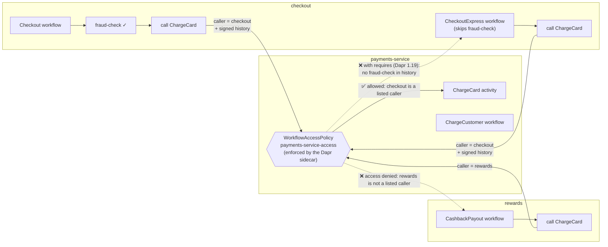

# checkout: Workflow Access Policies on Catalyst

Three apps share one Catalyst project. Only one of them should be able to charge a card.

- **payments-service** (`payments-service/main.go`) hosts the `ChargeCard` activity and the `ChargeCustomer` workflow. It contains no authorization code.
- **checkout** (`checkout/main.go`) runs `Checkout`: `fraud-check`, then a call to `ChargeCard` on payments-service.
- **rewards** (`rewards/main.go`) is a loyalty service. Its `CashbackPayout` workflow also calls `ChargeCard`, which it has no business doing.

A WorkflowAccessPolicy scoped to `payments-service` decides who may call `ChargeCard`. With no policy, every cross-app call is allowed. Once a policy is loaded, the target is locked down: any call that no rule allows is denied by the runtime before payments-service's code runs, and the denial is written to the caller's signed workflow history.



## Prerequisites

- A [Diagrid Catalyst](https://catalyst.diagrid.io) account.
- The [Diagrid CLI](https://docs.diagrid.io/references/catalyst/catalyst-cli-intro/), logged in with `diagrid login`.
- [Go](https://go.dev/dl/) 1.26.10 or newer.

## 1. Create a Project

History signing is not needed for this demo. You need it for the `requires` gate at the end, and it can only be set when the project is created, so turn it on now.

```bash
diagrid project create demo-wf-acl --enable-managed-workflow --enable-workflow-history-signing --wait --use
```

## 2. Run the Apps with `diagrid dev run`

Build the three apps and start them:

```bash
cd workflow-access-policies/checkout-go
go build -o bin/ ./...
diagrid dev run -f catalyst.yaml --project demo-wf-acl --skip-managed-pubsub --skip-managed-kv
```

`diagrid dev run` reads `catalyst.yaml`, creates an App ID in the project for each app (`checkout`, `payments-service`, `rewards`), and runs the three processes on your machine. Each app connects to its Dapr sidecar in Catalyst, so the workflows run locally and Catalyst stores their state, routes cross-app calls, and enforces access policies.

Wait until all three apps print `ready`:

```
== APP - checkout == checkout ready: hosting Checkout, CheckoutExpress
== APP - payments-service == payments-service ready: hosting ChargeCard, ChargeCustomer
== APP - rewards == rewards ready: hosting CashbackPayout
```

Leave this terminal running, because the app logs below appear here. Use a second terminal for the next steps. A `diagrid workflow start` with no apps running still returns `202`, but the workflow stays pending until an app picks it up.

## 3. No Policy: Anyone Can Charge a Card

```bash
diagrid workflow start CashbackPayout --id rewards --instance-id cashback-001 -p demo-wf-acl \
  -d '{"orderId":"CASHBACK-001","customer":"MALLORY-4111","amount":99000}'
```

```
== APP - payments-service == >>> ChargeCard: CASHBACK-001  $99000.00  MALLORY-4111  CHARGED
```

The loyalty service just charged $99,000. Nothing stopped it, because without a policy every cross-app call is allowed.

## 4. Create a Policy: Locked Down by Default

Create a policy for `payments-service` with no rules:

```bash
diagrid workflow access-policy create payments-service-access --scopes payments-service -p demo-wf-acl --wait
```

Now run a legitimate order from `checkout`:

```bash
diagrid workflow start Checkout --id checkout --instance-id order-001 -p demo-wf-acl \
  -d '{"orderId":"ORDER-001","customer":"ACME-4242","amount":250000}'
```

The fraud check passes, but the workflow fails at `ChargeCard` and nothing prints in payments-service. Open the `order-001` execution in the [Catalyst web console](https://catalyst.diagrid.io), or from the CLI:

```bash
diagrid workflow get order-001 --id checkout -p demo-wf-acl
```

```
  failureDetails:
    errorMessage: "task failed with an error: access denied by workflow access policy"
...
- eventType: TaskFailed
  metadata:
    failure_details_error_message: access denied by workflow access policy
    name: ChargeCard
  verificationStatus: verified
```

A policy is an allow-list. Once one is loaded for an app, every cross-app call to it is denied until a rule allows it. Calls an app makes to itself are always allowed. The denial is part of the signed history, which makes it evidence you can hand to an auditor.

## 5. Update the Policy: Allow Only checkout

```yaml
# policy.yaml
apiVersion: dapr.io/v1alpha1
kind: WorkflowAccessPolicy
metadata:
  name: payments-service-access
scopes:
- payments-service          # the app this policy protects
spec:
  rules:
  - callers:
    - appID: checkout       # the only app allowed in
    workflows:
    - name: ChargeCustomer
      operations: [schedule]
    activities:
    - name: ChargeCard
```

The rule lets `checkout` call the `ChargeCard` activity and schedule (but not terminate, purge, or read) the `ChargeCustomer` workflow.

```bash
diagrid apply -f policy.yaml -p demo-wf-acl
```

Run the order again with a new instance ID:

```bash
diagrid workflow start Checkout --id checkout --instance-id order-002 -p demo-wf-acl \
  -d '{"orderId":"ORDER-002","customer":"ACME-4242","amount":250000}'
```

```
== APP - checkout == >>> fraud-check: ORDER-002  $250000.00  ACME-4242  PASSED
== APP - payments-service == >>> ChargeCard: ORDER-002  $250000.00  ACME-4242  CHARGED
```

Then try `rewards` again:

```bash
diagrid workflow start CashbackPayout --id rewards --instance-id cashback-002 -p demo-wf-acl \
  -d '{"orderId":"CASHBACK-002","customer":"MALLORY-4111","amount":99000}'
```

It fails with `access denied by workflow access policy`. `checkout` is the only app that can charge a card.

## What's Next: `requires` (Dapr 1.19)

The policy checks *who* is calling, not *what they did first*. `checkout` also has a `CheckoutExpress` workflow that calls `ChargeCard` without a fraud check, and the policy allows it:

```bash
diagrid workflow start CheckoutExpress --id checkout --instance-id express-001 -p demo-wf-acl \
  -d '{"orderId":"ORDER-003","customer":"UNKNOWN-0001","amount":900000}'
```

Dapr 1.19 adds `requires` to a rule, and `policy.yaml` includes it commented out. The caller sends its signed workflow history with the call (`workflow.WithHistoryPropagation(workflow.PropagateOwnHistory())` in `checkout/main.go`). The target's runtime verifies the signatures and allows the call only if the listed events are present, in order:

```yaml
    activities:
    - name: ChargeCard
      requires:
      - eventType: activity.completed
        name: fraud-check
        appID: checkout
```

With this rule, `Checkout` still charges the card and `CheckoutExpress` is denied.

> **Note:** `requires` is available in open source Dapr 1.19 and is coming soon to Catalyst. Until then, it stays commented out in `policy.yaml`.

## Clean Up

```bash
diagrid project delete demo-wf-acl
```
